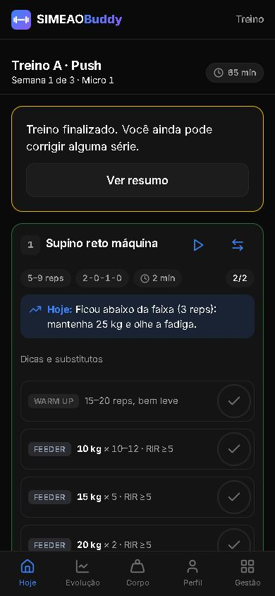
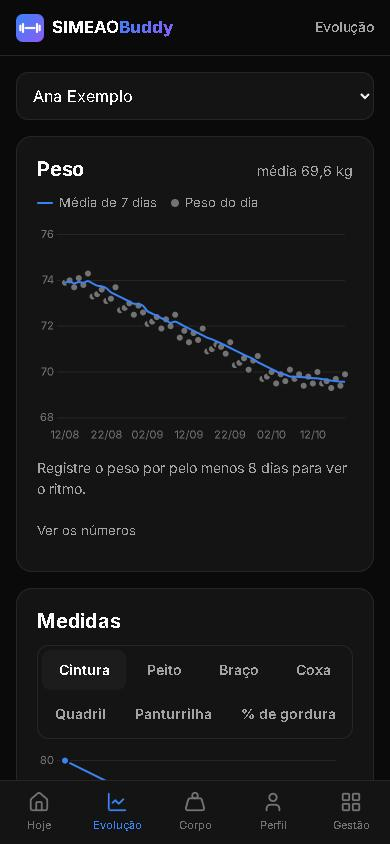
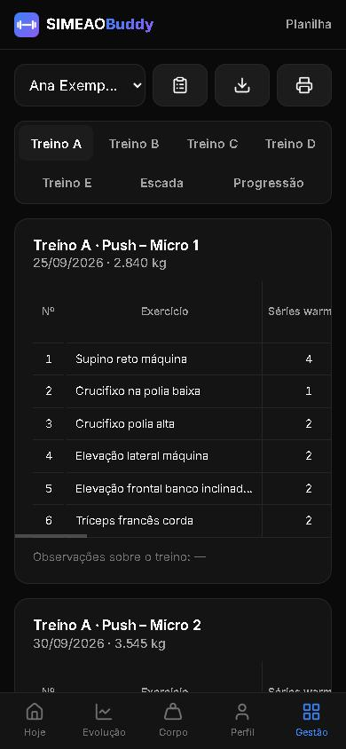
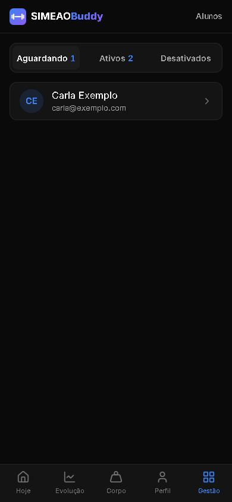

# SIMEAOBuddy

App de treino **low volume** (PWA) para um treinador e um grupo pequeno de alunos, feito para usar no celular, dentro da academia.
Substitui uma planilha de treino e fichas em PDF: programa com volume em escada, ficha do dia com séries preparatórias calculadas,
timer de descanso, registro das séries, progressão de carga, análise de fadiga e evolução do corpo.

> **Projeto de portfólio.** Este repositório tem só **dados fictícios** (a "Ana Exemplo", o "Bruno Exemplo" e a "Carla Exemplo").
> A versão usada de verdade, com os alunos reais, fica num repositório privado.

| Ficha do dia | Evolução | Planilha | Alunos |
|---|---|---|---|
|  |  |  |  |

## O que ele faz
- **Programa em escada (3 semanas):** o número de séries de trabalho sobe semana a semana; a faixa de repetições fica fixa.
- **Ficha do dia:** aquecimento e séries preparatórias com a carga calculada, timer de descanso com vibração, registro de carga × reps e
  sugestão de carga para hoje (dupla progressão).
- **Progressão e fadiga:** 🟢🟡🔴 por exercício contra o microciclo anterior, recorde (e1RM) e sugestão de deload quando a fadiga sobe.
- **Corpo e evolução:** peso diário com média móvel, medidas, fotos e gráficos.
- **Treinador × aluno:** o treinador monta os programas; o aluno entra com Google (fica aguardando aprovação) e só vê os próprios dados.
- **Offline:** instala no celular (PWA) e registra séries sem internet; sobe tudo quando a conexão volta.
- **Exportar:** planilha Excel por microciclo, ficha para imprimir/PDF e backup em JSON.
- **Android:** empacotado como APK (Trusted Web Activity).

## Tecnologia
Node.js 24 + Express · banco `node:sqlite` (um arquivo, sem servidor de banco) · HTML/CSS/JS puro em ES modules, sem build ·
Chart.js · ExcelJS · testes com `node --test` (136 testes).

Decisões que valem a pena olhar:
- **Regras de treino como funções puras** em `src/treino/` (escada, feeders, tonelagem, progressão, fadiga). O servidor e o navegador
  usam o mesmo arquivo, então a conta é igual nos dois lados.
- **Segurança:** sessão em cookie httpOnly (o banco guarda só o hash), senha com scrypt, bloqueio após 5 erros, Content-Security-Policy,
  dados da API sem cache e permissão conferida em toda rota (o aluno só acessa o que é dele).
- **Offline:** service worker gerado pelo servidor (versão muda sozinha) e fila de séries em IndexedDB.

## Rodar a demonstração
1. Instale o **Node.js 24**.
2. No terminal:
   ```
   git clone https://github.com/lucasasimeao/simeaobuddy.git
   cd simeaobuddy
   npm install
   npm run seed
   ```
3. Suba o app no banco de exemplo (PowerShell):
   ```
   $env:DB_PATH="data/exemplo.db"; npm start
   ```
4. Abra http://localhost:3100, clique em **Sou o treinador** e entre com usuário `exemplo` e senha `exemplo123`.

O login dos alunos com Google é opcional: veja [`DEPLOY.md`](DEPLOY.md).

## Comandos
| Comando | O que faz |
|---|---|
| `npm start` | Sobe o servidor na porta 3100 |
| `npm test` | Roda os testes |
| `npm run seed` | Cria o banco de exemplo `data/exemplo.db` com os alunos fictícios |
| `npm run criar-admin -- <usuario> "<nome>"` | Cria o admin num banco novo (a senha vai em `$env:SENHA`) |

## Organização
```
server.js            liga o servidor
src/app.js           monta o Express (rotas, segurança e arquivos da tela)
src/treino/          regras de treino (funções puras, também servidas ao navegador)
src/routes/          API (auth, alunos, exercícios, programas, treinos, corpo, evolução, exportar, backup)
src/db/              conexão, migrações numeradas, seed da biblioteca, do modelo e dos dados de exemplo
public/              telas (SPA com rotas por hash), tema, ícones e service worker
test/                testes (node --test)
docs/                especificação (pesquisa, plano, decisões, método de treino e requisitos)
```

Feito com o Claude Code, seguindo a especificação da pasta `docs/` e as regras do [`CLAUDE.md`](CLAUDE.md).
